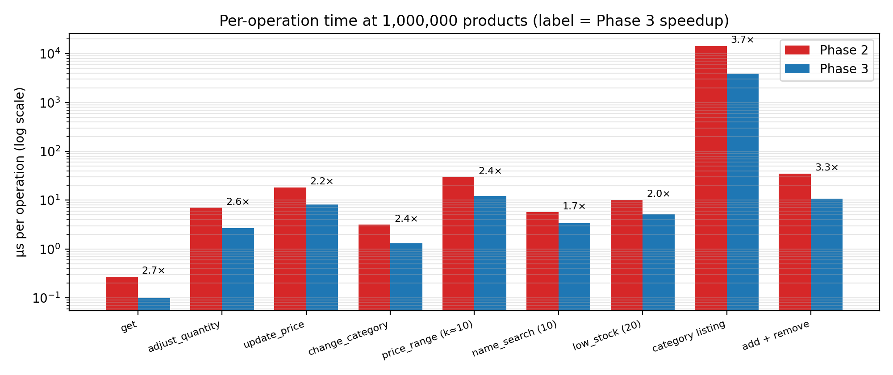
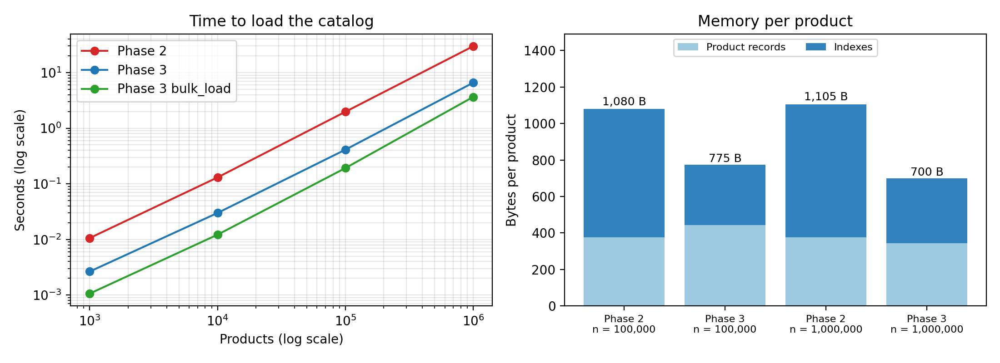

# Dynamic Inventory Management: Optimization, Scaling, and Final Evaluation

Skyler Troxell  
School of Computer and Information Sciences, University of the Cumberlands  
MSCS-532: Algorithms and Data Structures  
Project Deliverable 3: Optimization, Scaling, and Final Evaluation  
November 21, 2026  
GitHub Repository: https://github.com/Skyboxii/MSCS532_Project3  

## Introduction

The Phase 2 proof of concept was correct, but it was not built for volume. Before changing any code, I profiled it on a simulated store day of 50,000 mixed operations against 100,000 products, and froze a copy of the Phase 2 package so every comparison runs the same work on the same data. The rule I follow in integration work applied here too: measure first, because the slow part is rarely where you expect it.

### Optimization Techniques

The profile pointed to a handful of costs, and the largest was a surprise: updating a product re-validated every field, even when only the quantity changed. Table 1 lists each cost, the optimization aimed at it, and the measured effect at one million products.

**Table 1.** *Optimizations, the Phase 2 Cost Each Removed, and the Result at 1,000,000 Products*

| Optimization | Phase 2 cost removed | Result (Phase 2 → Phase 3) |
|---|---:|---:|
| Field-level validation (`evolve`) | Every update re-validated every field (23% of time) | Stock update 7.0 → 2.7 µs |
| Built-in `dict` for tables | Pure-Python probing (18% of time) | Lookup 0.27 → 0.10 µs |
| Blocked sorted index | Skip-list pointer chasing | Price range 29.8 → 12.3 µs |
| Lighter undo log | Closures and a generator per step (21%) | Add + remove 35.3 → 10.8 µs |
| Cached category order | Re-sorted every listing | Listing 14.4 → 3.9 ms |
| Bulk load with shadow build | One transaction per product | Load 29.8 → 3.6 s |
| Slots, shared prices, array heap | Per-object dictionaries and lists | 1,105 → 700 bytes per product |

Two decisions deserve explanation. First, I moved the product table from my own hash table to Python's built-in `dict`. Both use open addressing, so the algorithm did not change; the difference is that `dict` runs in C. I kept my table and improved its algorithm instead: deletions now shift later entries back into the freed slot (Knuth, 1998) rather than leaving tombstones. Second, I replaced the skip lists with a blocked sorted index, which stores keys in sorted arrays of about 512 entries. This is the B-tree idea of large nodes (Bayer & McCreight, 1972), which keeps related keys next to each other in memory and avoids cache misses (Rao & Ross, 2000).

Caching and memoization filled in the rest. Each record computes its price in whole cents and its lowercase search key once, instead of on every comparison. Category listings are cached and dropped only when a category gains or loses a product, so a sale does not invalidate them. Prices are shared objects, the flyweight pattern (Gamma et al., 1994), because a million products have only about 100,000 distinct prices.

### Scaling Strategy

Loading a large catalog one product at a time paid the full transaction cost per product: 29.8 seconds for a million. The new `bulk_load` builds every index off to the side from a single sort, builds the heap in linear time (Floyd, 1964), and then swaps the finished indexes in. If anything fails before the swap, the inventory is untouched, which is the shadow-paging idea (Lorie, 1977) and needs no undo log. A million products now load in 3.6 seconds. CSV import uses the bulk path only when the file adds at least a quarter to the catalog, because rebuilding a million entries to add ten is a bad trade.

Memory fell from 1,105 to 700 bytes per product at one million products, a 37% cut, mostly in the indexes (Figure 2). The trade-off showed at 100,000 products, where the records grew from 375 to 443 bytes: the cached keys cost memory, and shared prices only pay off once prices start to repeat. The hardest scaling problem came from the runtime itself. At four million products, the first 5,000 updates after a load averaged 107 µs instead of 4.0, because Python's garbage collector deferred a full pass over the millions of new objects to whatever ran next. Pausing the collector during the load removed the stall; the indexes hold no reference cycles, so nothing is lost by waiting.

### Testing and Validation

Optimization is only useful if the answers stay the same, so the most important new test is differential. It runs 18,000 random operations, a third of them deliberately invalid, against both the frozen Phase 2 package and the optimized one, and requires the same result or the same error message every time. The scripted demonstration also produces a transcript identical to Phase 2's, byte for byte, and all 26 injected mid-update failures still roll back completely. In all, 87 unit tests pass.

Stress testing with unexpected input found five ways for a raw Python error to escape, most of them present since Phase 2. A price near 1026 crashed decimal rounding, "-0.00" was stored as a negative zero, and three methods raised `TypeError` on the wrong argument type. Each now raises a clear inventory error. At 1, 2, and 4 million products, every index passed a full integrity check, and a single transaction of 100,000 updates that was deliberately aborted restored the inventory exactly, in 1.9 seconds at the largest size. A delete-heavy test confirmed the hash-table change: with tombstones, a failed lookup scanned 804 slots on average and up to 2,757, while backward shifting averaged 6 and removed the 3.8 ms rehash pauses.

### Performance Analysis

Figure 1 compares each operation at one million products. Every operation is faster, from 1.7 times for name searches to 3.7 times for category listings. On the mixed store-day workload, throughput rose from 90,641 to 186,428 operations per second, and both versions produced the same checksum. From one to four million products, a lookup went from 0.49 to 0.57 µs, a stock update from 3.6 to 4.0 µs, and the low-stock report stayed at about 5.1 µs, while mixed throughput only fell from 159,206 to 122,843 operations per second.

**Figure 1.** *Time per Operation at 1,000,000 Products, Phase 2 Versus Phase 3*

**Figure 2.** *Catalog Load Time and Memory per Product*

### Final Evaluation

The final solution runs each operation 1.7 to 3.7 times faster than the proof of concept, uses 37% less memory, loads a large catalog 8 times faster, and gives the same answers. Its main limitation is the price-range query, which still slows as the catalog grows (12.4 µs at one million products, 31.7 at four million) because each result is fetched from a different place in memory. The system is also single-threaded, keeps everything in memory (about 2.5 GB at four million products), and pays Python's interpreter overhead on every step. The next steps follow from those limits: a transaction log so the inventory survives a restart, locking for multiple registers, and a compiled extension for the hottest paths. Every optimization here had to keep the same answers, and the tests show that it did.

## References

Bayer, R., & McCreight, E. (1972). Organization and maintenance of large ordered indexes. *Acta Informatica, 1*(3), 173–189. https://doi.org/10.1007/BF00288683

Floyd, R. W. (1964). Algorithm 245: Treesort 3. *Communications of the ACM, 7*(12), 701. https://doi.org/10.1145/355588.365103

Gamma, E., Helm, R., Johnson, R., & Vlissides, J. (1994). *Design patterns: Elements of reusable object-oriented software*. Addison-Wesley.

Knuth, D. E. (1998). *The art of computer programming: Vol. 3. Sorting and searching* (2nd ed.). Addison-Wesley.

Lorie, R. A. (1977). Physical integrity in a large segmented database. *ACM Transactions on Database Systems, 2*(1), 91–104. https://doi.org/10.1145/320521.320540

Rao, J., & Ross, K. A. (2000). Making B+-trees cache conscious in main memory. In *Proceedings of the 2000 ACM SIGMOD International Conference on Management of Data* (pp. 475–486). Association for Computing Machinery. https://doi.org/10.1145/342009.335449
